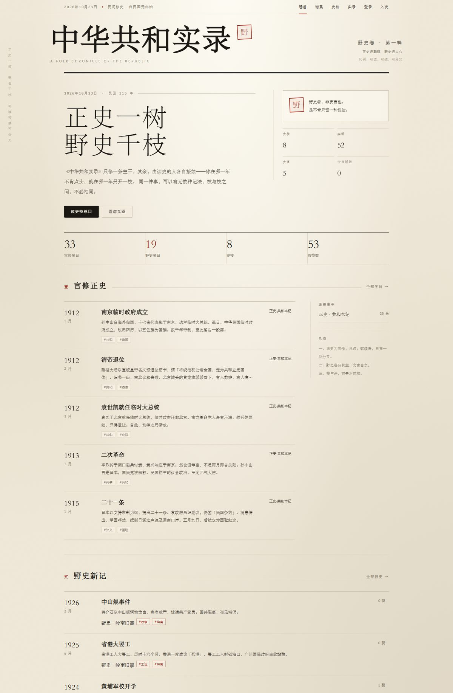
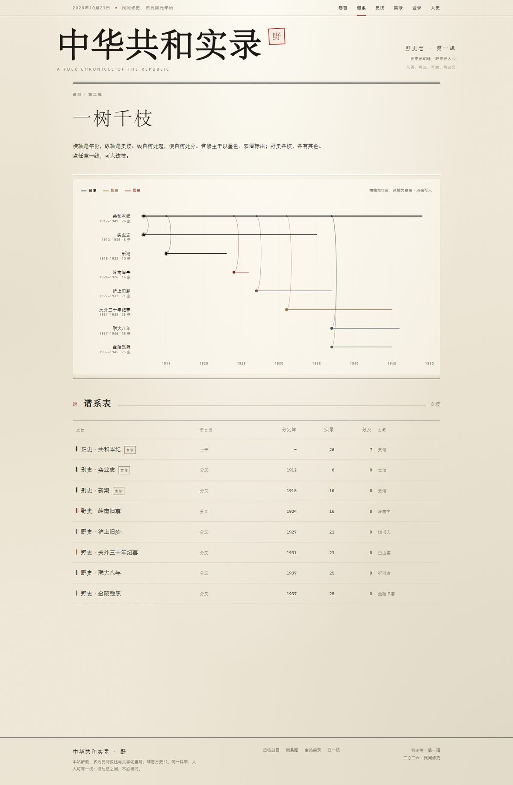
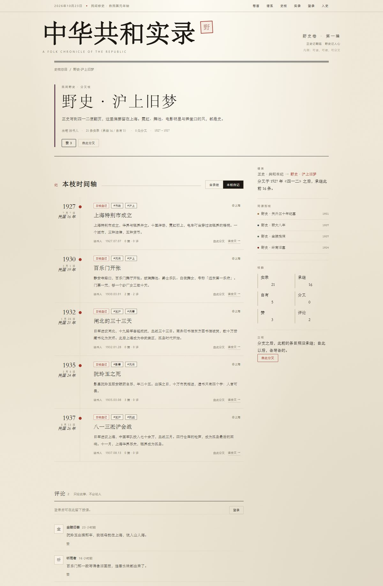

# 中华共和实录 · 野

> 一部可以分叉的民间民国史。

正史只修一条主干。其余由读史的人各自接续——你在哪一年不肯点头，就在那一年另开一枝。同一件事，可以有无数种记法；枝与枝之间，不必相同。



## 这是什么

一个「民间野史」写作与阅读站点。它借用 Git 的分支模型来组织历史叙事：

| 概念 | 对应 | 说明 |
| --- | --- | --- |
| 史枝 | Branch | 一条独立的历史叙事线。`正史·共和本纪` 是主干，其余都从某条条目上分叉而来。 |
| 条目 | Event | 一次「提交」：某年某月，某事发生。有标题、正文、地点、人物、标签。 |
| 承继 | Inherited | 分叉时，父枝在分叉点之前的全部条目会被带走，成为新枝的底稿。 |
| 分叉 | Fork | 从某条条目「自此分叉」，另立一枝，从那一刻往下写。 |
| 主笔 | Owner | 每条史枝有且只有一位主笔，只有他能续写；官修枝需先分叉才能写。 |

### 分叉的语义

- **按提交顺序截断，不按日期。** 分叉点记录的是父枝的第几条条目（`fork_event_id`）。父枝在分叉之后补录的、日期更早的条目，子枝**不**继承——这与 Git 的提交图一致。
- **承继是一次快照。** 分叉后父枝再改再补，都不会回流到子枝。
- **只有枝主能续写。** 官修枝（`official=true`）的主笔是「史馆」，普通用户只能先分叉，再在自己的枝上写。
- **计数是缓存的。** `inherited_count` + `event_count` 构成时间轴总数；写入时在同一事务里维护。

## 功能

- **卷首**：报头、正史编年、野史新记、史枝选刊、谱系缩略图。
- **谱系**：SVG 泳道图，横轴年份、纵轴史枝，分叉以贝塞尔曲线相连；下方附谱系表。
- **史枝总目**：按官修/野史筛选，按热度/新立/分叉/条目排序，可搜索。
- **史枝页**：枝头、谱系、同源枝、时间轴（可切换「本枝自记 / 含承继」）、点赞、评论、续写、改枝名、删枝。
- **条目页**：杂志式文章版式，首字下沉，人物与标签，前后条，点赞、评论、回复、以本条为分叉点。
- **全站实录**：跨枝检索，按年代/录入时间/赞数排序。
- **我的**：我的史枝、我的条目、所获赞数。
- **账号**：注册、登录、JWT 登录态；未登录可读，登录后可写。





## 技术栈

- 后端：Go 1.26、Gin、GORM、纯 Go SQLite（`glebarez/sqlite`）、`golang-jwt/jwt/v5`、bcrypt。
- 前端：Vue 3、TypeScript、Vite、Pinia、Element Plus、axios。
- 单二进制部署：后端同时提供 REST API 与 `web/dist` 静态文件，SPA 路由回退到 `index.html`。

## 目录

```
backend/
  cmd/server/main.go          启动、依赖装配、优雅退出
  internal/config/            环境变量与 SQLite DSN
  internal/db/                建库、迁移、索引
  internal/model/             User / Branch / Event / Like / Comment
  internal/service/           业务：史枝、条目、互动、种子史稿
  internal/handler/           HTTP 入参出参
  internal/router/            路由与中间件
  internal/middleware/        JWT、BodyLimit、限流、日志、恢复
  internal/response/          统一信封 { code, message, data }
web/
  src/views/                  卷首、谱系、总目、史枝、条目、实录、登录、我的
  src/components/             报头、页脚、史枝卡、谱系图、评论、分叉/续写弹窗
  src/api/                    axios 封装与类型
  src/styles/index.css        设计令牌与全部版式
docs/screenshots/             界面截图
```

## 快速开始

前置：Go 1.26+、Node 20+、pnpm。

```bash
# 后端（默认 :8090）
cd backend
go run ./cmd/server
```

首次启动会自动建库并灌入演示史稿：6 位史官、8 条史枝、52 条实录、13 条按语。数据落在 `backend/data/gonghe.db`。

```bash
# 前端开发服务器（:5173，/api 代理到 :8090）
cd web
pnpm install
pnpm dev
```

生产构建：

```bash
cd web && pnpm build
cd ../backend && go run ./cmd/server
# 打开 http://127.0.0.1:8090
```

### 演示账号

密码统一为 `123456`。

| 名号 | 署名 | 身份 |
| --- | --- | --- |
| `shuoshuren` | 说书人 | 《野史·沪上旧梦》主笔 |
| `baishanke` | 白山客 | 《野史·关外三十年纪事》主笔 |
| `tingyuzhe` | 听雨者 | 《野史·联大八年》主笔 |
| `jinling` | 金陵旧客 | 《野史·金陵残照》主笔 |
| `lingnan` | 岭南生 | 《野史·岭南旧事》主笔 |
| `shiguan` | 史馆 | 官修三枝的主笔（种子账号） |

## 配置

全部通过环境变量覆盖，默认值面向单机小站点。

| 变量 | 默认 | 说明 |
| --- | --- | --- |
| `ADDR` | `:8090` | 监听地址 |
| `APP_ENV` | `dev` | `prod` 时对弱配置告警 |
| `DATA_DIR` | `./data` | 数据目录 |
| `DB_PATH` | `./data/gonghe.db` | SQLite 文件 |
| `STATIC_DIR` | `../web/dist` | 前端产物；空则只提供 API |
| `JWT_SECRET` | 随机 | 未设置时启动生成临时密钥，重启后登录失效 |
| `JWT_TTL` | `168h` | 令牌有效期 |
| `ALLOW_REGISTER` | `true` | 是否开放注册 |
| `DEFAULT_PAGE_SIZE` | `20` | 默认分页 |
| `MAX_PAGE_SIZE` | `100` | 分页上限 |
| `DB_MAX_OPEN_CONNS` | `4` | SQLite 连接池 |
| `DB_BUSY_TIMEOUT` | `5s` | 写锁等待 |

## API

基础路径 `/api/v1`，统一信封 `{ "code": 0, "message": "ok", "data": ... }`；`code != 0` 即业务错误。

| 方法 | 路径 | 说明 |
| --- | --- | --- |
| GET | `/stats` | 全站统计 |
| GET | `/graph` | 谱系节点 |
| GET | `/branches` | 史枝列表（`scope/sort/q/page/pageSize`） |
| GET | `/branches/:id` | 史枝详情（含祖先、子枝、同源枝） |
| GET | `/branches/:id/timeline` | 时间轴（`own=1` 只看本枝自记） |
| POST | `/branches` | 分叉（登录） |
| PATCH/DELETE | `/branches/:id` | 改枝名 / 删枝（枝主） |
| GET | `/events` | 全站实录（`scope/sort/q/page/pageSize`） |
| GET | `/events/:id` | 条目详情 |
| POST | `/branches/:id/events` | 续写条目（枝主） |
| PATCH/DELETE | `/events/:id` | 改 / 删条目（枝主） |
| POST | `/likes` | 点赞切换 `{ targetType, targetId }` |
| GET | `/comments` | 评论列表（`targetType/targetId`） |
| POST | `/comments` | 发表或回复 |
| DELETE | `/comments/:id` | 删自己的评论 |
| POST | `/auth/login` · `/auth/register` | 登录 / 注册 |
| GET | `/auth/me` | 当前用户 |
| GET | `/me/branches` · `/me/events` | 我的史枝 / 我的条目 |

## 数据与重置

- 所有内容在 `backend/data/gonghe.db`（WAL 模式）。
- 种子只在**空库**写入；想重新灌入演示史稿，停服务后删除整个 `backend/data` 再启动。
- 索引在 `internal/db/db.go` 中显式创建：时间轴、热度、枝主、评论目标等。

## 视觉

取杂志索引的骨架，换成宣纸与朱砂的质地：

- 纸色 `#efe8d8`，墨 `#1b1814`，朱砂 `#a2362a`；另以赭石、黛青、苔绿、绛紫作野史枝色。
- 标题宋体，UI 无衬线，年份与数字用衬线大字；2px 圆角，细线分隔，阴影只给浮层。
- 版心 1120px；条目列表为「年份 / 正文 / 计数」三栏；详情页文章首字下沉。
- 页头常驻报头，卷首有竖排边注；谱系图为手绘感的细线泳道。

## 已知取舍

- SQLite 单机部署，未做多实例与高并发写入压测。
- 搜索为 `LIKE` 匹配，数据量大时应换 FTS5。
- 没有邮箱验证、找回密码、后台管理；官修内容由种子提供。
- 分叉继承在读取时递归展开（最多 24 层），适合目前的树深。

---

本站所载，多为民间叙述与文学化重写，非官方史料；同一件事，人各有枝，枝与枝之间，不必相同。
